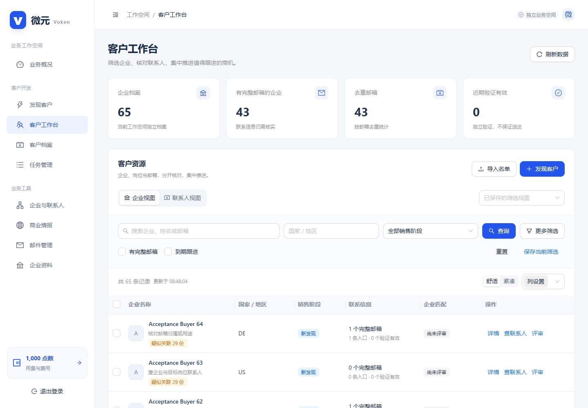
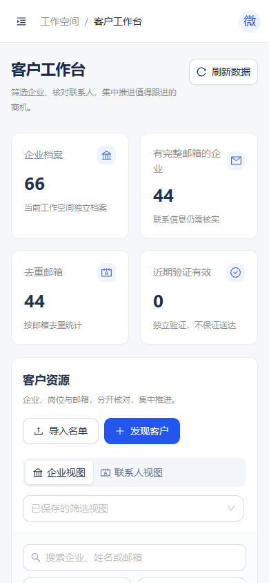

# 前台 API 集成与端到端验收

本轮在 React / Ant Design 界面细化后，重新测试服务端、整理运行时接口契约，并通过独立浏览器验证前台到 HTTP、数据库、后台任务的链路。

接口目录包含 **116 个操作、123 个模型**，按业务域分类；详见 [API 接口目录](./API接口目录.md) 和 [OpenAPI 快照](./api/openapi.json)。快照通过 `python scripts/export-api-catalog.py` 从当前代码生成，运行中的 `/openapi.json` 为权威契约。

## 前台调用对应关系

下表中工作空间接口均以 `/api/v1/workspaces/{workspace_id}` 开头。

| 前台流程 | 接口 | 集成规则 |
| --- | --- | --- |
| 注册、登录、退出 | `/api/v1/auth/verification-codes`、`register`、`login`、`logout` | 注册直接消费验证码挑战，不提前调用 verify；注册后单独登录。脚本未初始化时阻止表单默认提交。 |
| 点数与报价 | `GET /points`、`/points/costs`、`/points/quotes` | 使用服务端报价；账号切换清除上一账号余额。 |
| 企业与联系人列表 | `GET /crm/workbench` | `mode` 区分视图；`offset/limit=30` 分页；布尔筛选序列化为 true/false；只选择当前页，不伪装为全量选择。 |
| 保存筛选视图 | `GET/POST /crm/workbench/views` | 保存已应用条件；草稿尚未应用时禁用保存；恢复视图时重置缺省筛选。 |
| 详情与联系记录 | `GET /crm/prospects/{id}`、`/{id}/activities`、`/crm/workbench/history/{id}` | 从企业投影提取该客户全部候选；详情关闭保留列表位置；历史事件显示中文含义与关联邮箱。 |
| 企业评审 | `POST /crm/workbench/assessments` | 新增独立评审，不覆盖原始证据、旧评审或销售阶段。 |
| 回复、退信、拒绝联系 | `POST /crm/workbench/events` | 传 Idempotency-Key；退信和拒绝联系要求明确关联邮箱；记录后刷新投影。 |
| 批量跟进 | `POST /crm/workbench/followups` | 传 Idempotency-Key；日期转为带时区 ISO；后续间隔最多 5 个、递增不重复、1–90 天。成功后清除选择；不自动发送邮件。 |
| 邮箱独立验证 | `GET /crm/workbench/capabilities`、`POST /verifications` | 使用独立能力接口中的 `email_verification`；仅本次明确勾选才传 `confirm_external_check=true`；保留幂等键与历史。 |
| 名单导入 | `POST /crm/workbench/imports/preview`、`/imports/commit` | 预览用 multipart，由浏览器生成 boundary；核对映射、来源和确认后再提交。 |
| 客户编辑与备注 | `PATCH /crm/prospects/{id}`、`POST /{id}/activities` | 保留 expected_version，冲突不强行覆盖；备注与原证据分开。 |
| 开发信草稿 | `POST /crm/prospects/{id}/drafts`、`GET /jobs/{id}` | 草稿异步生成；轮询任务终态，仍需用户审阅后通过已配置通道发送。 |
| 找客任务 | `POST /agents`、`POST /agents/{id}/runs`、`GET /jobs/{id}` | runs 使用 Idempotency-Key；202 为已受理；每 5 秒更新执行中任务。增强档没有费用确认时不得提交。 |
| 周期任务 | `PUT /agents/{id}/schedule`、`GET /schedules` | 有限次数、带版本，当前只执行基础公域档，不自动进行付费数据增强。 |
| 企业资料、情报、邮件、费用 | 见接口目录对应业务域 | 继续通过兼容层调用现有接口，保留鉴权、版本、能力开关与人工确认。 |

所有业务请求携带 Bearer token，工作空间取当前登录结果，不由任意表单指定。401 清除会话；跨工作空间访问返回 404。没有 refresh token 接口。网络超时不自动以新 key 重做可能已有副作用的提交。

## 本轮修正

- 标记未应用的筛选草稿；展示可移除的已应用条件；已保存视图显示当前匹配项。
- 表格行密度、显示列可记忆；表头和分页处于有界滚动区域；窄屏提示横向滚动。
- 区分初始无客户、筛选无结果和加载失败，分别提供发现、清空筛选和重试入口。
- 客户详情增加固定底部操作、中文历史、空历史说明和合法日期降级显示。
- 表单提交中锁定编辑及关闭操作；按钮按评审、进展、提醒分别命名，并给出成功反馈。
- 补齐滚动测量与弹窗锁定辅助样式的 CSP nonce；继续保持脚本同源和样式 nonce 策略。
- 统一可见消息；兼容层保留提示节点，不再同时显示两套通知。
- 更新旧静态入口测试；修正 OpenAPI 中“没有周期拓客接口”的过时说明。

## 自动验收

后端全量回归命令：

```powershell
.venv/Scripts/python.exe -m unittest discover -s tests -v
```

本轮全量回归 **177 项通过**。包含鉴权、工作空间隔离、版本冲突、企业资料、获客、数据增强、点数与账单、联系人、工作台、邮件、支付回调、周期计划及 OpenAPI 契约等模块。新增的前台契约测试核对筛选参数、请求体和幂等头，不把 HTTP 头大小写差异误判为契约变化。

前端状态及兼容层检查：

```powershell
node tests/web_ui_checks.cjs
node tests/workbench_ui_checks.cjs
node tests/react_bridge_checks.cjs
node tests/react_ui_state_checks.cjs
```

前端构建与浏览器端到端测试：

```powershell
cd frontend
npm ci
npm run build
npm run test:e2e
```

Playwright 自动启动独立的 `127.0.0.1:18087` 测试服务，使用临时 SQLite、合成客户、独立浏览器上下文。测试不拦截业务 API 来伪造成功响应；前台请求经过实际 FastAPI 路由、数据校验、数据库和后台 Worker。

浏览器覆盖：筛选草稿与应用、保存视图、密度恢复、分页、详情、评审、联系事件邮箱绑定、未配置验证禁用、批量提醒与间隔校验、CSV 预览导入、旧客户表单与异步草稿、费用确认拦截、基础找客排队与结果、各导航页、390px 布局、退出与跨账号隔离、注册挑战与登录。

浏览器结果与截图写入 `.local/react-e2e/`；失败自动保留 trace。端到端运行时同时检查 JavaScript 与 CSP 错误，不通过隐藏错误来使测试通过。

最终结果：**177 项后端回归、10 条浏览器端到端用例、4 组前端检查通过，TypeScript 与生产构建通过**。[机器可读结果摘要](./api/verification-summary.json)。

桌面预览（合成测试数据）：



390px 手机端预览（合成测试数据）：



## 验收边界

第三方模型、搜索和外部通信使用确定性的测试替身；真实的短信送达、收费数据供应商、支付和邮件送达不在本轮自动外发验收范围。它们的接口约束、确认、幂等及异常路径由后端回归覆盖，不能据此宣称真实第三方通道已经完成投产联调。

既有开发账号未写入合成客户。生产未部署。当前复杂业务表单仍通过兼容层运行，后续迁移应遵守 `frontend/README.md` 的 DOM 与事件边界。
