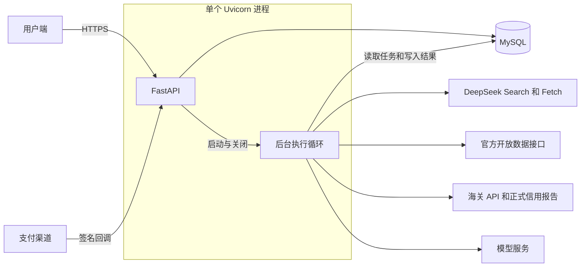

# 微元 1.0 服务端技术架构

架构评审稿 v0.6 · 2026-11-16

关联文档：[服务端需求](./微元1.0服务端需求文档.md) · [拓客能力设计](./微元1.0拓客能力设计.md)

## 1. 架构决策

采用 **Python + FastAPI + MySQL**。首版部署一个 FastAPI 应用实例，启动一个 Uvicorn 进程。HTTP 接口和后台任务使用同一应用进程。MySQL 保存业务数据、计费账本、任务和恢复进度。

| 决策 | 首版方案 |
| --- | --- |
| HTTP 服务 | FastAPI、Uvicorn、Pydantic。API 处理认证、授权、读写和任务提交，通过任务 ID 查询长任务结果。 |
| 持久化 | MySQL 8.4 系列、InnoDB、`utf8mb4`，采用 SQLAlchemy 和 Alembic。业务时间统一存 UTC，按用户时区展示。 |
| 租户 | 一个工作空间对应一个租户。共享数据库和表，用 `tenant_id`、授权校验与数据库约束隔离租户。用户和租户通过成员表关联，注册时建立默认工作空间。 |
| 后台任务 | 应用启动时启动一个后台执行循环，关闭时停止领取任务。任务和步骤写入 MySQL，首版按队列串行运行。 |
| 外部接口 | 公域网页搜索使用 DeepSeek Search 和 Fetch 适配器。官方开放数据、海关、信用报告、支付和模型分别封装。每个适配器负责鉴权、超时、错误分类和成本记录。 |
| 报告存储 | MySQL 保存结构化报告和可授权访问的来源引用。实际需要持久化大文件时，可增配私有对象存储。 |

## 2. 组件与部署拓扑

| 模块 | 职责 |
| --- | --- |
| `identity`、`tenancy` | 中国大陆手机号和密码注册登录、会话、租户成员、角色和请求上下文。 |
| `billing` | 套餐版本、订单、支付回调、订阅、操作扣点规则、点数账本和供应商支出。 |
| `agents`、`jobs` | 实例配置及版本、运行任务、步骤进度、重试和取消。 |
| `sources`、`entities` | 建立来源适配器和数据授权策略，规范化企业和来源记录，管理候选主体匹配。 |
| `prospecting`、`intelligence` | 构造结构化查询、生成候选、核验证据、排序并生成可引用的报告。 |

首版可将应用和 MySQL 部署在同一台主机，或让应用连接独立的托管 MySQL。应用按单进程托管，异常退出由进程管理器重启。发布时先停止旧进程，再执行数据库迁移并启动新进程，允许短时维护窗口。对账等维护工作可由后台循环按固定间隔检查并写入任务表。

## 3. 多租户隔离

1. **鉴权上下文。** 根据登录凭据确认用户身份。请求路径中的工作空间 ID 只用于选择目标空间，鉴权依赖负责校验当前成员关系和权限，生成包含 `tenant_id`、用户 ID、角色的上下文。提交增强核验时校验订阅权益，后台任务在付费调用前再次检查对应权限与额度。
2. **数据库约束。** 所有租户私有表带非空 `tenant_id`。查询、更新和删除都带 `tenant_id` 过滤条件。关键关联使用 `(tenant_id, id)` 复合外键，避免线索、任务和报告相互引用到其他租户。关键查询索引以 `tenant_id` 及筛选字段组合设计。MySQL 共享表的租户访问边界依赖应用层和表约束共同执行。
3. **异步与报告访问。** 后台执行循环从持久化任务恢复租户上下文，步骤状态、结果和引用按该上下文读写。报告和授权附件的读取先校验租户与资源权限。私有缓存键和幂等键在租户范围内生效。
4. **共享数据。** 获准复用的公开企业档案及公域来源记录可存于共享库表。用户查询条件、私有线索、报告、未获共享授权的第三方响应留在对应租户。全局企业匹配结果须有来源。租户私有的备注、联系人或信用信息只在该租户的工作流中使用。
5. **管理权限。** 平台运营访问使用单独的授权路径，记录操作者、目标租户、动作和原因。跨租户管理查询、对象访问和队列维护使用专门权限。

## 4. 逻辑数据模型

| 表组 | 核心表 | 约束与用途 |
| --- | --- | --- |
| 账号及租户 | `users`、`tenants`、`tenant_members` | `users.phone_e164` 全局唯一，密码以安全散列保存。成员关系唯一键 `(tenant_id, user_id)`。 |
| 数字员工及任务 | `agent_instances`、`agent_config_versions`、`jobs`、`job_steps` | 实例保存状态、当前配置版本和删除时间。运行引用不可变的配置版本并保存输入快照。任务提交幂等键按租户和操作作用域唯一。步骤结果按任务及稳定步骤键去重。 |
| 企业及来源 | `companies`、`company_source_refs`、`source_records`、`tenant_source_records` | 供应商记录以来源、数据集及源记录 ID 建立唯一性。区分共享和私有证据，保留来源、原始时间、获取时间、授权及内容版本。 |
| 线索及报告 | `leads`、`lead_evidence`、`reports`、`report_evidence` | 一次任务内按租户和企业去重。报告重新生成时新增版本并引用当时采用的证据。 |
| 支付及订阅 | `plan_versions`、`orders`、`payment_events`、`subscriptions` | 订单保存套餐价格与权益快照。支付渠道事件 ID、确认交易 ID 去重。 |
| 点数及外部调用 | `point_wallets`、`point_ledger`、`point_rate_versions`、`provider_calls` | 余额按租户存储，流水记录赠送、预占、扣减及释放。扣点规则按操作和版本存储。供应商支出单独记录。 |

来源的企业 ID 与微元企业 ID 单独维护映射。优先用可核实的登记号和辖区匹配，名称或官网相近时保留待核验关系。固定筛选和计费字段使用结构化列。JSON 用于来源扩展字段、查询参数及配置快照。权限过滤、去重和账本查询使用常规索引，外部搜索索引按实际数据量评估。

## 5. 单实例后台任务

### 5.1 数字员工生命周期

| 用户操作 | 实例与任务处理 |
| --- | --- |
| 创建 | 校验工作空间的创建权限和实例名额，写入暂停状态与首个配置版本。实例计数更新与创建在同一事务内完成，避免并发超额。 |
| 修改配置 | 新增不可变版本并更新当前版本指针。排队和运行中的任务继续引用已绑定版本。 |
| 启动 | 在同一事务内锁定实例、检查状态与权益、设为已启用、绑定当前配置版本并创建任务。同一实例有未结束任务时拒绝新启动。相同幂等键重放返回原任务。 |
| 暂停 | 锁定实例并更新为暂停，标记关联的排队或运行中任务取消。排队任务直接取消，运行中任务在当前步骤结束后取消。清理未使用的额度。 |
| 删除 | 写入删除时间，执行同样的任务取消流程并释放实例名额。实例从正常列表隐藏，历史结果由工作空间历史入口按资源权限读取。重复删除不重复释放名额。 |

启动、暂停和删除事务按实例行串行化。后台循环在启动下一步骤前再次检查任务取消标记和实例状态。对于付费调用，在同一短事务内检查标记、预占预算并记录调用意图，提交后才访问外部接口。已经进入执行的步骤可保留结果并按实际情况结算，后续步骤停止。重启时优先处理取消标记，再恢复其他任务。

### 5.2 提交、执行和恢复

1. API 校验租户、权限和参数，在同一事务中创建任务、绑定智能体配置版本并预占相应用户额度。事务提交后返回 `202 Accepted` 和任务 ID。重复请求使用相同幂等键取回原任务。同一幂等键携带不同参数时返回冲突。
2. 应用内唯一的后台执行循环按状态和可运行时间读取待执行任务。用短事务把任务从待执行更新为运行中并记录尝试次数，提交后再访问外部接口。后台网络请求使用异步客户端，阻塞操作通过线程执行，避免长任务占用 HTTP 事件循环。
3. 每个步骤完成后保存结果、分页位置或报告进度，并使用稳定步骤键去重。关闭时结束当前步骤或留下恢复进度。应用启动时检查遗留的运行中任务，从已保存的进度恢复或转为待核对。该恢复流程以旧进程已经退出为前提。
4. 临时故障有限次重试，记录下次可运行时间。永久错误保留原因和已有结果。取消通过持久化标记在步骤边界生效，已经发出的外部调用按对账规则处理。

异常退出可能导致未确认的步骤再次执行，数据库结果通过步骤唯一键和条件更新去重。付费调用在发送前保存调用意图、预算预占和请求标识。重启或请求超时后，优先查询供应商状态或账单。有可靠幂等支持时可按同一标识重试，其余调用转待核对。

### 5.3 执行配额与降级

- 为每个租户设置待处理任务上限和调用预算。后台循环按可运行时间处理任务，并按供应商限频规则暂停或延后步骤。
- 普通拓客的付费商业数据预算为 0。流程优先查授权缓存和开放接口，再补公域搜索，提取官网、产品、渠道、采购公告和政策证据。搜索及模型分别限制调用数、结果大小和超时。缺少公域证据时返回已查范围及剩余缺口。
- 增强核验由用户选择。后台任务在外部调用前原子预占供应商预算，优先获取最小范围证据。已核验交易、公开采购信号、产品匹配和正式信用报告在数据模型中使用独立证据类型。
- 单个来源失败时保存其他来源的结果。为单次查询设置超时，为后台任务设置处理时长上限。通过任务等待时间和 API 延迟判断单实例是否满足首批容量需求。

### 5.4 DeepSeek 公域搜索适配器

适配器使用异步 HTTP 客户端向 `LLM_BASE_URL=https://api.deepseek.com` 发送 JSON 请求，通过服务端注入的 `LLM_API_KEY` 做 Bearer 鉴权。模型请求使用 `LLM_MODEL=deepseek-flash`，用于结构化查询和生成报告。Search 和 Fetch 使用独立的工具接口，由后台任务控制查询计划、原文读取次数和用量。真实密钥通过部署环境注入。[DeepSeek 模型列表](https://api-docs.deepseek.com/zh-cn/api/list-models/) · [网页搜索与抓取](https://api-docs.deepseek.com/zh-cn/guides/search/)

| 接口 | 微元使用方式 |
| --- | --- |
| `POST /v1/tools/search` | 校验 `query` 为 1–128 个 Unicode 字符，`count` 为 1–50。常规发现只取标题、摘要和链接，针对少量已限定站点的查询可用 `need_content=true` 同时取正文。默认省略 `ori_question` 和 `localization`。 |
| `POST /v1/tools/fetch` | 搜索结果缺少核验所需正文时，按预算读取选定的公开 HTTP(S) URL。发布机关和企业官网优先。已取得的可用正文直接复用。 |

- **结果规范化。** 将 `title`、`url`、`site_name`、`date` 及摘要映射到来源记录，并由微元记录检索时间和结果状态。`date` 缺失时保留未知值。`rerank_score` 和 `authority` 只作为采样排序信号，主体身份、政策状态及生效日仍用原文核验。任务按授权保存证据元数据，可回溯到原文链接。
- **预算与计费。** Search 和 Fetch 分别限频与记账。接入时参考官方公布的账号上限 Search 100 QPS、Fetch 25 QPS，Fetch 另受目标域名限频。每个任务另设更低的请求数和超时预算。公开价两项均为 5 元／千次成功且有结果的请求。搜索空数组、抓取无正文和失败单独记录。供应商成本用可保存 0.005 元的定点精度，按账号账单核对。[DeepSeek 计费与限速](https://api-docs.deepseek.com/zh-cn/guides/search/#计费)
- **异常处理。** Search 返回空数组时记为无匹配，Fetch 无可用正文时将该条留作待核验。对明确收到的限流或临时故障响应执行有限退避。API Key 无效或余额不足时停止该来源并告警，有有效缓存时带检索时间返回。客户端超时导致响应未知时按供应商成本对账规则处理。
- **数据边界。** 发给 DeepSeek 的内容限于检索必要的企业、市场及产品词和公开 URL。调用日志过滤密钥，私有查询和响应按租户及授权隔离。抓取结果作为外部数据处理。

## 6. 支付、订阅与点数一致性

| 流程 | 一致性设计 |
| --- | --- |
| 注册与赠点 | 首次注册在同一事务建立账号、默认工作空间、成员关系及点数钱包，发放 1,000 点。手机号唯一约束防止重复建号，赠点流水以账号和活动类型作为唯一业务键。 |
| 运营配置 | 后台预设人民币标价 1,000 点对应 100 元。纳入计费的操作由 `default_operation_cost` 提供默认值 1，按操作配置的整数扣点优先。任务保存提交时的生效规则版本和预占点数，配置变更对新提交生效。 |
| 创建订单 | 服务端按套餐版本计算金额、币种及权益快照，用整数最小货币单位保存金额。记录提交幂等键。 |
| 确认支付 | 验证渠道签名，按订单、金额、币种和交易号校验。事件去重、订单状态推进和订阅权益生效在同一事务内完成。迟到或重复事件按状态机处理。 |
| 到期与退款 | 新任务在提交时检查有效权益。退款事件和对账调整使用同一状态机并留痕。历史结果和在途任务的权益生效规则以产品决策为准。 |
| 并发用量 | 以租户定位点数余额。先校验功能权限，再以条件更新或行锁原子预占点数，余额不足返回业务错误。按任务和流水类型幂等结算或退回剩余点数。 |
| 供应商成本 | DeepSeek 模型、Search、Fetch、海关及信用核验的成本按供应商单独记录。用户点数按产品规则扣减。外部扣费未确认时保留平台预算预占，直到对账或运营处理。 |

## 7. API 边界

工作空间接口统一使用 `/api/v1/workspaces/{workspace_id}` 前缀。下表路径以该前缀为基准。任务查询支持分页、状态及时间筛选。分页读取使用稳定排序键。

| 方法与路径 | 用途 |
| --- | --- |
| `GET /agents`、`GET /agents/{agent_id}` | 查看未删除的数字员工、当前配置版本及启用状态。 |
| `POST /agents`、`PATCH /agents/{agent_id}` | 创建数字员工或修改运行配置，并产生配置版本。 |
| `POST /agents/{agent_id}/runs` | 启动数字员工并提交一次运行，返回任务 ID。 |
| `POST /agents/{agent_id}/pause` | 暂停数字员工，并请求停止关联任务。 |
| `DELETE /agents/{agent_id}` | 删除数字员工，保留历史任务和结果。 |
| `POST /public-searches` | 查询企业、地区或国家的公域动态。 |
| `GET /jobs`、`GET /jobs/{job_id}`、`GET /jobs/{job_id}/leads` | 查询工作空间运行历史、处理状态及线索。历史列表可按数字员工 ID 筛选，包含已删除员工的历史任务。 |
| `POST /leads/{lead_id}/verifications` | 提交用户选定的交易或信用核验类型、范围及预算。 |
| `POST /reports`、`GET /reports/{report_id}` | 创建和读取有版本、可回溯证据的情报报告。 |
| `POST /orders`、`GET /subscription`、`GET /usage` | 下单和查看订阅及用量。 |
| `GET /points`、`GET /points/ledger` | 查看工作空间可用点数、已预占点数和流水。任务提交前的报价返回操作类型、所需点数及规则版本。 |

注册、登录和支付回调使用独立入口。任务提交和订单创建支持 `Idempotency-Key`。支付回调使用渠道签名及事件唯一键。错误响应包含稳定错误码和请求 ID，便于区分额度不足、来源不可用、访问拒绝及业务冲突。

### 7.1 手机验证码接口

| 方法与路径 | 请求及结果 |
| --- | --- |
| `POST /api/v1/auth/verification-codes` | 传入 `phone`，返回 `challenge_id` 和 `expires_in_seconds`。接受本地及 `+86` 格式的大陆手机号。 |
| `POST /api/v1/auth/verification-codes/verify` | 传入 `phone`、`challenge_id`、`code`，校验成功返回 `verified: true` 并消费挑战。验证码错误、失效或手机号不一致时返回对应的失败响应。 |

测试实现通过 `VerificationProvider` 接口注入，只在显式配置 `APP_ENV=test` 时启用固定验证码 `123456`。挑战在单进程内存中保存，5 分钟有效，最多尝试 5 次，成功后失效。同一号码申请新挑战时，旧挑战失效。其他环境未配置供应商时返回 `503`。正式注册接入时应由服务端调用验证接口的业务实现消费挑战，与手机号绑定。正式供应商可替换测试实现，并按需增加短信发送、限频和持久化。

本地启动测试接口时，先执行 `python -m pip install -r requirements.txt`，再设置 `APP_ENV=test` 并启动 `python -m uvicorn app.main:app`。启动后可从 `/docs` 请求和验证验证码。

## 8. 安全、运维与发布

- **数据访问。** 短期访问凭据、密码安全散列、密钥集中托管、传输加密和数据库最小权限。供应商密钥和支付凭据不进入模型输入、客户端响应或普通日志。数据按来源授权设置保存期限及引用权限。
- **公域抓取。** 外链读取限制协议、大小和超时，检查 DNS 解析结果与重定向目标，拦截私网及云元数据地址。将网页正文作为外部数据处理，模型输出须通过结构化校验。外部网页内容不能授权模型调用付费工具或读取租户数据。
- **监控。** 用请求 ID、任务 ID 和供应商调用 ID 关联结构化日志。关注 API 延迟与错误率、任务积压、执行失败、重启恢复、供应商限流和对账差异。记录每条有效线索的公域及商业数据成本。
- **部署与恢复。** 测试和生产使用独立数据库与密钥。发布流程依次执行停止应用、迁移数据库、启动应用和健康检查。定期备份 MySQL 并验证恢复后的租户数据、任务进度及计费账本。

## 9. 实施与验证

| 阶段 | 交付与验证重点 |
| --- | --- |
| 1. 服务骨架与租户 | 建立单个应用入口和数据库迁移。覆盖双租户 API 读写、资源关联、异步结果和私有缓存隔离。 |
| 2. 公域拓客与报告 | 验证数字员工生命周期、并发操作与重启恢复。覆盖 DeepSeek Search 有结果、空结果和限流，以及 Fetch 无正文、原文复用和来源引用。分别断言公域工具记账正确及默认路径零次付费商业数据调用。 |
| 3. 支付与增强核验 | 接入选定渠道和供应商。覆盖重复及乱序回调、并发请求消耗最后一份额度，以及供应商已扣费但响应超时的对账。 |
| 4. 上线演练 | 验证停机发布、健康检查和 MySQL 备份恢复。通过试跑确定单实例可承载的任务量、预计等待时间和恢复目标。 |

评审待确认项包括生产主机与 MySQL 部署方式、支付及数据供应商、订阅失效或退款时的权益规则、首批任务量和数据保留周期。
