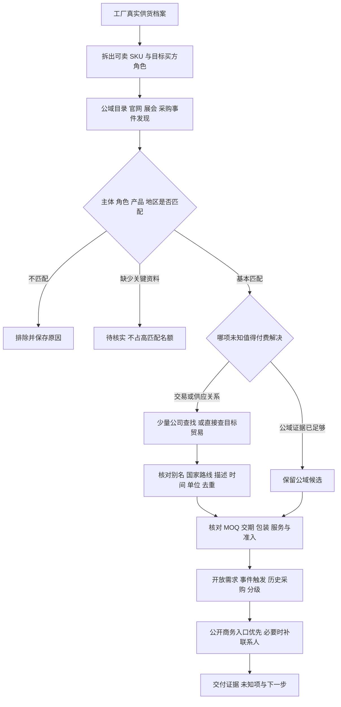

# 珠海及周边小 B 外贸获客：真实数据实测与筛选逻辑

研究日期：2026-11-20。状态：完成探索性验证；筛选方案待产品实现与业务转化验证。

香港时间 09:24:48 开始，约 10:06 结束，研究及整理约 41 分钟，未用满两小时。停止新增付费查询后完成证据核对与方案整理；没有为消耗剩余额度而继续扩查。

## 1. 决策结论

建议默认采用：**供货能力建档 → 公域确认买方业务 → 小批量魔方核验 → 逐项匹配 SKU、订单与履约条件 → 分级交付 → 最后补联系方式。**

跨境魔方最有价值的用途，是帮助判断一个已初步匹配的客户“曾向谁、采购过什么、何时采购”。本次实测不能支持“有海关记录就有当前采购需求”，也不能支持“调用更多接口必然提高线索有效率”。

对珠海及周边的小外贸团队，优先验证**已有相近产品、经营渠道明确、能接受对应供货方式的进口商、批发商、自有品牌商或本地中标经销商**。直接找大型终端招标或大型品牌总部，需要额外的准入、库存和服务能力，不能只按采购规模优先。

本轮整理了 11 个重点审查案例：6 个可继续核实的采购候选、1 个事件触发候选、4 个暂缓或有明显限制的案例。**当前开放且已确认工厂可参与的 RFQ 为 0；已确认可直接报价的完整机会为 0。**这不表示市场上没有需求，而是本次证据尚未达到该标准。未发送开发信、未联系买方、未验证回复率或成交率。

## 2. 场景为什么这样选

先看本地产业及供应方的具体能力，再选择检索场景。本轮不是区域企业普查，也没有获得工厂内部经营数据；以下是有真实企业产品与供货条件支撑的场景模型，不能据此认定每家企业均符合统计意义上的“小微企业”。

| 区域与场景 | 实际供应方依据 | 小外贸团队需要解决的问题 |
| --- | --- | --- |
| 珠海：兼容打印耗材及维修配件出口 | MaiGe 官网展示兼容耗材、翻新组件及 B2B 渠道定位；FAQ 区分标准型号 10–50 件与部分定制包装 500 件 MOQ。属于供应方自述，实际型号与条件需询厂确认。 | 多型号混批、芯片/固件适配、兼容新品与再制造品的区别；找区域分销和维护渠道，避免把原厂体系或回收商当作通用兼容耗材买家。 |
| 中山小榄：机械球锁、执手锁、死锁及贴牌出口 | Maxal 官网列出机械门锁、试单、打标 500 件、彩盒 1,000 件、约 50–60 天交期。其自述约 101–200 人，作为配套工厂的能力样本，不代表极小型工厂。 | 门锁结构、门厚、孔距、锁芯和表面处理适配；标准试单与自有品牌包装应分别判断 MOQ。 |
| 江门：不锈钢 GN 盆、食物盆及配套件出口 | Zhaosheng 的供应商主页展示江门地址、OEM/ODM、样品服务；GN 产品目录分别出现 100 件、300 件等 MOQ。具体产品页提供尺寸、厚度和样图定制信息。 | 美国 food pan、chafer insert 与标准 GN 盆不必然互换；要核对尺寸、材质、厚度、盖口和模具，不能用“厨具”统配。 |

产业选择依据：[珠海相关产业规划](https://www.zhuhai.gov.cn/attachment/0/441/441312/3936452.pdf)、[小榄锁具出口基地与中小企业产业集群](https://www.zs.gov.cn/xlz/tpxw/content/post_2453655.html)、[江门不锈钢餐厨企业出海活动](https://www.jiangmen.gov.cn/bmpd/jmsswj/gzdt/content/post_3441508.html)。这些材料支持产业关联，不证明任一家工厂的实时产能或出口资质。

供货条件来源：[MaiGe 介绍](https://maigetoner.com/about)、[MaiGe FAQ](https://maigetoner.com/faq)、[Maxal 服务与 MOQ](https://www.maxallock.com/services-support.html)、[Zhaosheng 供应商信息](https://jmzhaosheng.en.made-in-china.com/)、[GN 产品目录](https://jmzhaosheng.en.made-in-china.com/product-group/oqraxzMKZikF/GN-Pan-1.html)、[GN 产品规格页](https://jmzhaosheng.en.made-in-china.com/product/fvjmUsnMYxGd/China-Restaruant-Kitchenware-Stainless-Steel-Full-Size-Gastronorm-Containers-Gn-Pan.html)。网页宣传、平台认证标识均不能替代本轮未进行的工厂审核。

主检索市场选择美国耗材/餐厨渠道与墨西哥五金渠道，另抽查巴西耗材、英国餐厨。市场选择同时考虑能找到的公开买方证据及数据可验证性，不是利润、关税、运费或区域市场吸引力排名，也不意味着当地工厂应只做美墨市场。

## 3. 实际做了什么，消耗多少

### 范围与计量

研究从香港时间 **09:24:48** 起计，最迟截止 **11:24:48**。贸易查询主窗口为 2025-11-20 至 2026-11-19，时间戳按 UTC 构造；少数已知企业名称查询不设贸易日期限制，用于身份补查。下文贸易日期统一由返回毫秒时间戳转换为 UTC 日期，不能用提单号中的日期替代。

| 项目 | 本轮实际 | 用户上限 | 口径 |
| --- | ---: | ---: | --- |
| 找公司 | 19 次请求，246 条返回记录 | 500 | 含重复与无关记录；230 个不同 companyId，不等于 230 个独立企业 |
| 海关 | 19 次请求，208 条返回记录 | 10,000 | 202 个不同 UUID；一条明细不等于一个订单或一次独立采购 |
| 联系方式 | 3 次单公司请求，0 条返回，0 条解锁记录 | 20 | 查询 Chapa、Eastern、XSE 均为空；不是获得了 3 个有效联系人 |
| 账户检查 | 1 次 | — | 不算找公司或海关记录 |

每个请求先占最坏上限，再发起调用。本地保守预占为公司 380 条、海关 380 条；联系方式按每家公司最多六类解锁预占，共 18 类。这是研究脚本的防超限措施，**不是供应商实际扣量**。真实 `usage.records.used` 累计为 `SEARCH_RECORD=246`、`TRADE_RECORD=208`、`UNLOCK_RECORD=0`，与返回量对得上。3 次联系方式请求仍消耗请求配额。

所有搜索/核验响应均为 `billingMode=PLAN`，回传现金费用合计为 0。**套餐额度被消耗，不能称为零成本。**按官网可见按次价“公司列表/贸易列表 1.5 元、联系方式 0.5 元”作替代计费试算，38 次列表查询为 57 元，3 次联系方式尝试若按次收费为 1.5 元，合计约 **58.5 元**。这不是本账号实际账单，空结果、批量、套餐及合同价仍需按供应商规则对账；公域搜索、读取网页、模型和人工时间未计入该试算。[官方价目](https://developer.upkuajing.com/openapi/)

### 实验方式与限制

比较了模糊产品词、精确产品词、HS、当地语言词、企业 ID 和企业名称查询，随后对有价值的候选回查官网及目标产品明细。查询根据观察逐步调整，**属于探索性研究，不是随机样本或严格 A/B 实验**。没有对 246 条公司记录逐条做独立盲审，因此不计算总体精准率、召回率或“提升百分比”。

巴西精确耗材查询只返回 1 条原厂企业，英国 GN 词查询返回 3 条记录；这只描述这组参数与接口的返回情况，不能推出当地只有这些买家或没有市场。

## 4. 真实命中揭示的问题

| 实测 | 返回及核验结果 | 必须进入逻辑的规则 |
| --- | --- | --- |
| 美国 `toner cartridge` 模糊查询，首 20 条 | 出现滤芯、加热棒、家具；`countryCode` 还包含 CL、PE | 产品语义与国家必须回查；不相信请求过滤器必然保证输出正确 |
| 墨西哥 `door lock` 模糊查询，首 20 条 | 汽车、骨科固定物、手套、物流等混入 | “lock”不等于建筑机械锁，加入用途与结构核验 |
| 美国 `steam table pan` 模糊查询，首 20 条 | 大量家具、table 相关结果，并有 VN 国家代码 | 先抽一页校准，失真就修词，不直接翻页扩大数量 |
| 精确 `door lock` + HS830140 | 2 条，仍包括智能锁或非目标应用 | 精确匹配、HS 都不能代替实际用途判断 |
| 同窗口精确 `door lock`，不加 HS | 20 条，发现 JAKO、Herrajes del Caribe，也仍混有车辆、电子设备和货代 | 与上一行只比较是否加 HS；不能将结果变化归因于语言 |
| 同窗口精确 `cerradura de pomo` | 5 条 ID 记录，包括 AGM 两个 ID 的机械球锁描述 | 当地术语补召回；5 个 ID 不是 5 家最终客户，也不能据此声称精准率更高 |
| GN 改用 `gastronorm / steam table pans / food pan` | 20 条里出现 Eastern、Bon Chef、Darling，也出现塑料、铝箔盘、船名、货代及“不含 food pan”的描述 | 单复数与别名用于召回，材质/产品层级/否定词用于筛选；多词组合语义不能靠猜测 |
| 名称模糊查 `EASTERN TABLETOP`、`IMAGE STAR` | 各返回 20 条，很多只是包含 EASTERN 或 STAR 的其他企业 | 已知主体优先精确名称；相似名称不自动关联官网 |
| 名称精确查 Eastern Tabletop | 15 个 ID/别名记录，存在旧址、空名和地址异常 | 按法律主体、域名、地址归并；异常 ID 留待复核，不整批合并 |
| AGM 按单一 ID 查贸易，再按精确名称补查 | 单 ID 结果最新 2026-01-21；名称查询发现另一个 ID 的 2026-03-25 记录 | 一家公司可有多个来源 ID；“补查更晚记录”不等于全部别名已确证为同一法人 |
| JAKO 概览与目标贸易分开看 | 公司页概览较新，`door lock` 明细本次最新 2026-03-27；混合描述还包含智能锁 | 企业最近有进口，不等于最近采购目标 SKU |
| 以墨西哥买方筛选 Herrajes del Caribe/JAKO | 返回明细抵运国 US；JAKO 起运国 CO，而供方名称部分似中山企业 | 买方所属国、卖方所属国、起运国、抵运国分开存；不擅自改成 CN→MX 或认定转口原因 |
| PSU 两种正式/品牌名称查询 | 都无命中，但政府原文已有新一期耗材合同获批 | 海关无命中保留公域证据；需要区分库覆盖不足与没有采购需求 |
| 联系方式试查三家公司 | 三次成功响应但全为空 | `code=0`不等于获取成功；已有官网商务入口时优先复用，连续空结果停止补查 |

另一个接口观察：尽管公司查询传入 `sorting_field=latestTradeDate`、`sorting_direction=desc`，多组返回日期未按降序排列。先按“排序未验证”处理，不能声称首 20 条就是最新 20 家。不能仅在这一页自行重排后宣称完成全库最新排序。

## 5. 候选审查：保留什么，为什么暂不算有效商机

下表的“最新”均指**本次特定 ID/名称、产品条件和分页范围中观察到的最新记录**，不是企业全球最后采购时间。B1/B2 只表示贸易证据年龄，不代替供货匹配。完整分级定义见第 6 节。

### 可继续核实的六个采购候选

| 候选与场景 | 观察到的证据 | 当前判断与下一项核实 |
| --- | --- | --- |
| **Chapa / Dexter，墨西哥门锁** | 官方品牌页说明 Dexter 属于 Chapa，产品含 tubular 机械门锁；魔方 ID20479332，2026-03-26，供方 Zhongshan Huibao，有死锁、执手/表面安装锁等行，数量字段含 240、2,520、3,036 PIECES | B2。经营模式和相近产品有依据；核对具体 SKU、门厚孔距、试单/打标/彩盒 MOQ、是否接纳新供应商。不能用其中 240 件推定满足 500 件打标 MOQ。 |
| **AGM / FMX，墨西哥五金自有品牌** | 官网 FMX 有球锁、重型执手和其他锁型；ID83169616、91268746 的记录出现门锁，其中名称补查最新 2026-03-25，部分行单位 PIECES，部分为空 | B2。先核准两个 ID 的主体关系，再针对木门球锁/执手锁核实；玻璃锁、铝门锁不可一并算匹配。 |
| **FERRETSA，墨西哥五金渠道** | 官网有自有品牌与渠道业务；ID94027629，2026-02-15 本次目标锁具记录，单位 PIECES | B2。核对其品牌下具体机械门锁型号、补货计划及供应商准入。品牌活动只能补充跟进背景。 |
| **XSE / ImageStar，美国耗材批发渠道** | ImageStar 官网销售 OEM 与兼容耗材，提供 Hyperion 产品线；XSE 官网也有自有品牌及厂商合作入口。XSE ID71507540 于 2026-09-25 有 toner/kit/empty cartridge 混合描述记录，起运 CN、抵运 US，数量 **300 CARTONS** | B1，身份关联及具体产品仍有待确认。官网与海关地址等线索用于关联，不能仅靠名称归并；300 箱不是 300 件，记录也未提供可直接匹配的型号。厂商合作入口不等于当前采购单，准入、质量与退换货承接需单独验证。 |
| **Eastern Tabletop，美国餐厨品牌** | 官网有不锈钢 food pan；ID221366 的目标产品查询有 2026-06-10、2025-12-01 两条中国供方记录；数量 47、25，**单位为空** | B1。不能用 47 对比 MOQ100/300；其目录含圆、方及 chafer 配套形状，先取得目标尺寸/接口和材质要求，确认本地工厂能做的 SKU。 |
| **Bon Chef，美国餐厨渠道/品牌** | 官方 food pan 类目存在；ID15682204 本次 food pan 5 条记录、3 个不同日期，最新 2026-02-27；供方来自印度，数量单位缺失 | B2。确有相近采购证据，但未证明要切换中国供方；需要核实材料、规格、MOQ和新供应商开放程度。5 行不能写成 5 个采购订单。 |

官网事实来源：[Dexter 品牌主体](https://www.cerraduras-dexter.com.mx/about-us/)、[Dexter 产品](https://www.cerraduras-dexter.com.mx/product/37)、[AGM 的 FMX 目录](https://agmherrajes.com/fmx/)、[FERRETSA](https://ferretsa.com/)、[ImageStar 介绍](https://www.imagestar.com/about_us.html)、[Eastern 食物盆](https://easterntabletop.com/product/stainless-steel-food-pans/)、[Bon Chef 食物盆](https://www.bonchef.com/shop/cookware/shop-by-category-cookware/food-pan/)。海关事实来自本地保存的魔方原始响应，索引见第 10 节。

补充的进入路径证据：[XSE 官网](https://www.xsegroup.com/)同时列出自有品牌、物流和厂商合作，说明不能见到一家企业有物流业务就整家排除；需要判断具体产品采购角色。FERRETSA 在尼加拉瓜 2026-07-28 官方公报中出现 FERKY BASIC 非电动金属锁等商品的商标申请公告，可作为品牌布局信号，不能解释为注册已完成、采购 RFQ 或已有换供应商计划。[官方公报，第7948页](https://digesto.asamblea.gob.ni/consultas/util/pdf.php?rdd=KQVk1c27kqw%3D&type=rdd)

### 一个事件触发候选

**B2B Supplies USA / Printing Supplies USA**：DuPage County 原文显示，2026-11-10 已通过下一期原厂与再制造耗材供货合同，2026-12-01 至 2027-11-30，合同上限 49,410 美元。官网提供原厂、兼容与再制造产品，并有来自外部工厂的产品线。事实支持“存在新的履约期间”；**可能需要上游补货是推断**。该合同已经授出，不能展示为开放招标；金额也不是珠海工厂可获得的订单额。[政府原文](https://dupage.legistar.com/LegislationDetail.aspx?GUID=BFE2EEEF-86D4-4C2D-A6B6-FC37BC2DA29E&ID=8311088&Options=&Search=)、[其供货产品线](https://www.printingsuppliesusa.com/peppmlogin.aspx)

当前定为 P：事件触发、供货适配待核实。MaiGe 的兼容新品不自动满足这份合同的“再制造或原厂”要求；还需核对型号、产品路线、当地库存/服务和客户愿不愿更换供应商。魔方按 `B2B SUPPLIES USA` 与 `PRINTING SUPPLIES USA` 精确查询均为空，保留该线索并注明“海关未命中”。

### 四个暂缓/有明显限制的案例

| 案例 | 为什么不直接进入高匹配列表 |
| --- | --- |
| **PERFILETTO，MX，ID93131186** | 2026-09-28 有安全锁 100 PIECES 等记录；官网主要展示铝/玻璃系统相关锁具。对小榄 tubular 球锁能力模型，结构适配未成立。即使近期、数量小，也先暂缓。[官网锁类目录](https://www.perfilettoinnovation.com/index.php?action=catalogo&filtro=Cerraduras) |
| **Darling Food Services，US，ID473478** | 本次目标 food pan 明细最新 2026-01-13；官网销售渠道线索见 Wasserstrom。需先核实品牌、采购法人和渠道集团关系，避免把品牌与集团作为两个独立客户；无单位数量不做 MOQ 判断。[品牌销售页面](https://www.wasserstrom.com/store-darling-food-service) |
| **Herrajes del Caribe / Hardsan，MX，ID5149660** | 官方渠道页有五金与锁类业务；本次贸易 4 行同为 2026-04-21，抵运 US、单位 CARTONS，并有供方国家与名称疑点。可留公域渠道候选，但不能充当“中国直接进口到墨西哥”的已核验路线客户。[渠道介绍](https://hardsan.mx/blogs/contenido-de-valor/conoce-nuestra-tienda-en-linea) |
| **Productos JAKO，MX，ID73435805** | 官网主体与锁类目录清楚；本次目标贸易最新 2026-03-27，含智能锁混合描述，起运 CO/抵运 US，需要核对数据口径。不能用公司较新的概览时间替代目标机械锁采购时间。[官网](https://www.jako.mx/)、[产品分类](https://www.jako.mx/shop/category/herrajes-puertas-cerraduras-119) |

此外，T-Z Enterprises 看似普通贸易公司，但其官网明确物流转运业务，适合作为“隐蔽货代”排除样例。[其公司介绍](https://www.t-zusa.com/about) GREENCYCLE 有近期耗材记录，但型号适配及知识产权背景需人工核查；Canon 2021 年对特定型号/商品曾有公开投诉，不能扩大为对该企业所有产品或当前状态的判断。[历史原文](https://global.canon/en/news/2021/20210708a.html)

### 联系渠道的使用边界

官网已有 ImageStar、Eastern、Bon Chef、AGM、FERRETSA 等商务入口。公开的 sales、info、ventas 邮箱只能标注为“企业通用商务/销售入口”，不标注为采购负责人、邮箱可达或已建立联系。本轮不需要继续付费购买相同层级的通用邮箱。[ImageStar 联系页](https://www.imagestar.com/contact_us.html)、[Eastern 联系页](https://easterntabletop.com/contact/)、[Bon Chef 联系页](https://www.bonchef.com/contact-us-page/)、[AGM 联系页](https://agmherrajes.com/contacto/)

## 6. 可执行的筛选链路

### 6.1 供货档案是前置条件

至少保存：产品型号/尺寸/材质、兼容对象、标准品 MOQ、定制 MOQ、允许混款规则、样品、库存与交期、包装、已具备的测试/认证资料、价格条件、付款与售后、可承接市场、既有客户排除表。缺失项保留 unknown，不让模型补造。

例：只知道“做门锁”，不能区分木门球锁、玻璃夹锁、汽车门锁和电子门禁；只知道“兼容硒鼓”，不能判断能否提供再制造产品；只知道“不锈钢盆”，不能判定特定 chafer 配套件可以直接替换。

### 6.2 先用硬门槛，再排跟进顺序

逐项判定 `pass / fail / unknown`：

1. **主体**：公司存在，官网与法律主体关联有依据；排除只有运输代理角色的命中，以及船名/占位符。兼营物流与分销的企业按目标产品实际角色判断，不能只因有物流业务整家排除。
2. **买方角色**：真实经营或使用目标产品，并存在合理采购路径。生产商、代理商、终端不一概排除，而是分别判断其采购对象及进入方式。
3. **产品适配**：目标用途、结构、型号、材质与工厂 SKU 一致；有明确冲突就排除或换匹配产品。
4. **商业承接**：该 SKU 的量、包装、交期、库存、服务、准入能承接。海关混装总量不当作单型号采购量。
5. **市场/路线**：按用户要求区分“美国公司”“抵运美国”“从中国起运”；空值不自动通过严格路线条件。

关键门槛为 fail 的不能靠“贸易频次高”加分补回；为 unknown 的标明待核实，不计为已满足工厂条件。通过后按具体需求强度、证据新鲜度、现有供方关系、进入难度与联系方式完整度排序。暂不使用未经标注样本校准的“匹配度 93 分”。

### 6.3 需求证据等级

| 等级 | 要求 | 可以对用户说什么 |
| --- | --- | --- |
| A 当前开放需求 | 当前有效的 RFQ/采购说明，产品、数量、时限与采购主体可确认；工厂具备参与条件，关键承接项已核实 | “有当前开放需求，适合进入报价准备”；本轮 0 条 |
| P 事件触发候选 | 中标履约、渠道/产品扩张等真实事件，目标产品有关联，但尚无上游采购确认 | “有跟进触发信号，补货/换供方意愿待核实” |
| B1 近期历史采购候选 | 主体/业务有依据，观察到 180 天内目标产品贸易 | “近期采购过相近产品，当前需求及供货条件待核实” |
| B2 历史采购候选 | 181–365 天目标产品贸易；或需要进一步确认的历史记录 | “有历史采购证据”；不等于客户已不活跃 |
| C 渠道匹配候选 | 官网产品与角色符合，贸易无命中或覆盖不足 | “业务匹配，采购事实待确认” |
| H / X 暂缓或排除 | 关键未知、数据冲突或明确不符；分别存储原因 | 不挤占“已确认商机”的名额 |

180/365 天是初始操作阈值，不是经验证明的统一采购周期。按行业、SKU、供应季节和该国数据时效调整；记录数据覆盖日期。B/P 的任一关键供货门槛未知，都不能升级为“可直接报价”。

### 6.4 什么时候调用魔方

- **先明确问题再调用**：为确认目标采购事实查贸易；为找到缺失企业标识/供应关系查公司；为补缺失联系角色才查联系。已有企业名称时可以直接贸易查询，避免无条件先买公司列表和详情。
- **一页校准**：产品词/当地语言细词和 HS 分支分别试小页，核验其差异后再扩。不是每个同义词都翻多页；已知用户供方能力以外的产品词不扩。
- **主体关联后补别名**：保存 `source + endpoint namespace + companyId`，同时保留法律名称/品牌/地址/域名和关联依据。单一 ID 空结果可做一次有依据的名称补查，避免无限模糊查询。
- **明细带产品条件**：按买方、目标产品、时间、所需路线查；全品类贸易只做补充，不用于目标采购新鲜度。
- **页内/跨页去重**：UUID 去重复明细；再以已知提单/日期/主体组合组织贸易事件，保留多行商品，不把缺提单号的同日明细硬并成一票。重复查询仍记录实际成本与供应商扣量。
- **原始单位必留**：数量、单位、币种、金额、商品描述完整保存。空币种的 0 金额不推导单价；CARTONS 不转 PIECES；单位不明不与 MOQ 比较。
- **停止条件**：达到目标证据数量、连续两次扩展没有新增经人工确认的候选、接近任一预算、上游扣费未知，均停止新增调用并交付现有结果。连续两次是建议的初始策略，后续用标注数据校准。

## 7. 三个不同成本/复杂度层级

以下是**未来产品策略与预算建议**，不是本次逐档 A/B 实测结果。目标为一次任务交付最多 10 个分级候选，数量不足时如实交付。按次价试算仅包含魔方，公域、模型、人工成本另列。额度按请求前的最坏情况预占，超时不直接重试。

| 策略 | 获取逻辑及交付强度 | 建议魔方上限与预算 | 成本复杂度与有效性边界 |
| --- | --- | --- | --- |
| **一、公域筛选** | 官网产品目录 + 买方角色 + 地区 + 事件状态，补公开商务入口；交付 C/P 或有充分证据的 A | 公司/贸易/联系方式均 0；公域初始上限可设 20 次搜索、20 次页面读取 | 最低魔方成本，公域解析复杂度中等；适合低 MOQ 混批渠道。无法承诺历史进口事实，公开资料充分时也能发现强事件线索。 |
| **二、定向交易增强，建议默认增强策略** | 一的前筛后，对最值得跟进的候选核验目标贸易；未命中保留公域等级；缺企业身份时最多两页公司查找 | 公司 ≤2 页、贸易 ≤10 页、联系 ≤2 家；最坏返回公司40、海关200；公开按次试算 ≤19 元，可设20元任务预算 | 中等复杂度；减少错角色/错品类后再付费，证据解释更强。不会把缺型号、包装或库存能力的问题自动解决。 |
| **三、供货与进入路径深核** | 二的基础上，只深核3–5家：具体SKU、全部已确认别名、相近供方关系、采购事件、试单/包装/交付条件、准入与联系角色 | 公司总计 ≤4 页、贸易总计 ≤20 页、联系总计 ≤5 家；公开按次试算 ≤38.5 元，可设40元预算 | 最高人工/编排复杂度；适合中高价值贴牌单。更多明细不保证当前需求；无开放需求时仍只能交付 B/P，不伪装成 A。 |

二档预算算式：`(2+10)×1.5 + 2×0.5 = 19`；三档为 `(4+20)×1.5 + 5×0.5 = 38.5`。假设每页20条、每家公司联系方式一次，未包括详情、重试及其他接口，套餐模式须另记配额成本。10页交易可以核验多家，每家的别名补查也占总页数，不能在总预算外再加。

产品入口仍可只保留**基础/增强两档**：基础对应策略一，增强默认策略二；策略三作为增强任务内显式选择的深入核查范围与更高预算，不能因为一条“确认付费”就自动开启。这里不直接改动现有页面或后台配置，也不假定现有代码已支持上述预算。

## 8. 对当前实现的具体影响

本轮是独立研究脚本直接访问授权 API，**没有运行生产拓客任务、没有替换线上筛选逻辑、没有部署代码**。仓库已有的其他未提交改动保持原状。以下是落地优先项：

| 优先级 | 当前观察 | 建议改动与验收 |
| --- | --- | --- |
| P0 | `app/upkuajing.py` 从 `countryInfo.code_iso2` 读国家，但本次原始响应使用 `countryCode` | 兼容版本字段；保留原始国家与来源，不能用请求国填成已验证国家。用 CL/PE/VN 和缺国家样本验证不会误通过。 |
| P0 | 适配层读取 `productHscodes6`，实际响应含 `productHscode` 且常为 null；同时丢弃数量/单位/金额/路线 | 保留实际字段与空值，不能把 HS 请求条件当作明细返回值。以 300 CARTONS、47 空单位、JAKO CO→US 为真实回归样本。 |
| P0 | `evidence_result` 只返回现金费用；worker 成功后用回传0覆盖估算预算占用 | 新增 PLAN 请求/记录/解锁配额台账；货币预算与记录预算独立限制。当前仍有日调用上限，但不能因此认为已经控制本次这种记录数预算。测试现金0仍不能无限释放套餐任务限额。 |
| P1 | `app/enhancement.py` 固定先查一页公司、扩前5家查询、前2条有ID线索查贸易 | 以候选缺失证据和适配门槛分配预算；已有公域主体可直查贸易，覆盖不足再查公司。不让列表顺序决定核验名单。 |
| P1 | `search_buyers` 固定 `isExact=False` | 按产品词、当地语言和已知主体生成不同查询；用 EASTERN/STAR 假阳性和西语球锁样本检验。排序未验证时页面注明范围。 |
| P1 | 公司/品牌/多个来源ID容易被当成独立客户 | 独立 canonical entity 与来源ID映射；关联依据不足时不合并。用 Eastern 15条与 AGM 两ID测试不重复凑数、不漏别名。 |
| P1 | 统一“有效商机”容易混合历史采购与当前需求 | 输出证据等级、供货门槛状态、未知项和下一步；PSU 已授合同不得展示为开放 RFQ。 |
| P2 | 联系方式返回空、通用邮箱和决策人之间缺少业务区别 | 单独记录请求成功/结果为空/公开入口/具体采购角色/可达状态；三次空结果应触发停止。 |

接口参数依据：[公司列表](https://raw.githubusercontent.com/Upkuajing/upkuajing-trade-company-search/main/references/company-list-api.md)、[贸易列表](https://raw.githubusercontent.com/Upkuajing/upkuajing-trade-company-search/main/references/trade-list-api.md)、[联系获取](https://raw.githubusercontent.com/Upkuajing/upkuajing-trade-company-search/main/references/contact-fetch-api.md)。公开参考与实际返回存在差异时保留差异，不靠模型“修正”数据。

## 9. 如何验证“真正有效”

本轮能支持：发现并复核真实渠道、目标历史采购和多种错误类型；提出更可解释、可控制调用量的逻辑。**尚不能支持成交效果、回复率改善或单位有效商机成本下降的统计结论。**

下一阶段验证应先固定三家供应方的真实 SKU、MOQ、交期、服务能力和排除客户，再在同一市场/窗口中对三档策略使用相同候选评审口径。建议每场景人工盲审前20个去重候选，保存各策略检索范围，报告精确分子分母与未知比例；这是试验设计建议，不是已完成样本量。

| 指标 | 分子/分母与用途 |
| --- | --- |
| 主体与角色通过率 | 主体/买方角色均通过的独立候选 ÷ 被审查独立候选 |
| SKU 可承接率 | 具体产品及关键商业门槛均通过的独立候选 ÷ 被审查独立候选；unknown 不算通过 |
| 当前需求覆盖 | A 数量 ÷ 被审查独立候选；与 B/P 分开 |
| 历史贸易证据覆盖 | 有目标贸易证据的候选 ÷ 该策略交付独立候选；不能充当有效率 |
| 联系角色覆盖 | 有可核实采购/供应链角色的候选 ÷ 交付独立候选；通用邮箱另记 |
| 单位成本 | 真实现金成本、套餐扣量折算、公域/模型成本与人工时间分别记录，再除以 SKU 可承接候选或实际报价机会数 |
| 后续业务验证 | 经另行授权联系后，再记录有效回复、确认需求、样品、报价与订单；按唯一企业和相同观察窗口计量 |

本次没有授权外联，故最后一行没有观测数据。不得将“官网有产品”“海关有记录”“找到邮箱”合并成成交概率。

## 10. 可复查材料

完整参数、原始 API 响应和逐请求台账保存在本机 `.local/lead-research-20261120/`，该目录被 Git 忽略；包含账号配额等信息，不随报告公开发布。关键文件：

- `usage.json`：每次调用前的预算预占、状态、返回数与 requestId。
- `request-index.json`：逐请求摘要与实际配额扣量。
- `summary.json`：汇总量、去重 ID/UUID 数、排序检查。
- `*.params.json` / `*.response.json`：原始查询和完整响应。
- `run.py`：有本次固定截止时间、记录上限、同名请求防重复的研究执行器；不是生产任务入口。
- `reviewed-candidates.json`：本轮11个案例的证据链接、判定及不确定项。

重要请求的定位名：`verify-chapa`、`verify-agm-name`、`verify-xse`、`verify-eastern-food`、`verify-bonchef-food`、`verify-ferretsa`、`match-psu`、`match-psu-brand`、`verify-caribe`、`verify-jako`。请求索引附后，可由 requestId 回查供应商账本。

<!-- generated-request-index -->

### 请求索引（本轮共42次，含账户检查）

| 查询名 | 类型 | 返回条数 | requestId |
| --- | --- | ---: | --- |
| account-check | account | 0 | `8f5ca42f9f344940a9b912f47560eb6b` |
| printer-us | company | 20 | `bc4938b93625428a9b4fc969412fbfd6` |
| locks-mx | company | 20 | `34c50d3c103f4dbd8dc8465c975106e5` |
| gn-us | company | 20 | `de14a0977f1f4081add388fd797cff85` |
| printer-us-exact | company | 20 | `4c451576ae18492ab0f1d8922c170dde` |
| locks-mx-exact | company | 2 | `d6cecd6f1d974e8993bb8c914ee9c96a` |
| gn-us-exact | company | 0 | `5a5771fbf7f6403c920594b4c1d3026f` |
| locks-mx-hs | company | 20 | `c3812b6a50654b399d3804b9341045a7` |
| gn-us-terms | company | 20 | `43d55c22d6c248c38923bec1106b7f1c` |
| printer-us-p2 | company | 20 | `2d0807033312435d8c59b75d22bb5d0f` |
| trade-printer | trade | 20 | `c72e68eeee4f4c62b900fa4fc53db9c6` |
| trade-locks | trade | 0 | `02e755ea81454f699e0415ee5a8e7b80` |
| trade-gn | trade | 20 | `44653bf07baf4402b2388d5aa32e5b25` |
| printer-br-exact | company | 1 | `31b51d81a4324f9798a27aa99ab74f62` |
| gn-gb-terms | company | 3 | `15dd98c88dc24f63a4c22c6ca9104a59` |
| locks-mx-hs-p2 | company | 20 | `674ec304ead8473d8796054b540b6c89` |
| verify-chapa | trade | 20 | `31e8c687209846b2bbb436cec54ddc3e` |
| verify-agm | trade | 18 | `2904a0b7476140819f2ec9fff1a3eaa0` |
| verify-eastern | trade | 20 | `3bc23897a5674d94bc5acb1429dbf4b5` |
| verify-bonchef | trade | 20 | `6ccc37770ca7488d9bed5451d8e7b6d3` |
| verify-xse | trade | 1 | `6a34e83a262042e28b267f0bbdef0c62` |
| verify-greencycle | trade | 20 | `ca93485b3f594285b3f1fbf7d3a51f2a` |
| verify-darling | trade | 20 | `5542d427602042ef83d671ef051d1d5b` |
| verify-perfiletto | trade | 5 | `a3a55321713d4bc5a7aad3e1599c3e36` |
| verify-eastern-food | trade | 2 | `4eb00623e36a41519cb388bbff4e8696` |
| verify-bonchef-food | trade | 5 | `0ed9993187224846bf90c60174cdf657` |
| verify-darling-food | trade | 6 | `c89be821aae54f85831c22830ce874fd` |
| contact-chapa | contacts | 0 | `0255a27362414a19824a5196c373cddf` |
| verify-ferretsa | trade | 2 | `235b38a01e3644fbbdc5e08c5d0a53bb` |
| match-psu | company | 0 | `c74143350d31415785814b6c4b67a0a0` |
| contact-eastern | contacts | 0 | `cf7c131a141b44f2a48033b8e0447088` |
| contact-xse | contacts | 0 | `e92ed08eed8a4ff9be157c80b2972fd8` |
| match-eastern | company | 20 | `19e390600ef6478ca82b78de2d10ea14` |
| match-imagestar | company | 20 | `3cfdd498464b4ac4be7be6b7520b4343` |
| match-eastern-exact | company | 15 | `f5ba0d6fdc324a9392d73b50231bf0cc` |
| match-psu-brand | company | 0 | `c71607d74e3d45c784d5b892e069c709` |
| verify-agm-name | trade | 20 | `2d5d1cdc30f04680a402807d6a9670fc` |
| verify-xse-name | trade | 1 | `2b92ea89cdd64611a96ae8d904965213` |
| locks-mx-english-only | company | 20 | `a045b5c33d394ce5883279f004111962` |
| locks-mx-spanish | company | 5 | `7c270ab13205422795921775c80d9313` |
| verify-caribe | trade | 4 | `9f9b67ca4e28420f97ff33356997fe68` |
| verify-jako | trade | 4 | `4bc268b1e34d4cee8b97f9ca4682c1ee` |
